<!--
  Generated by Readme Studio (https://github.com/DavidNiessen/readme-studio).
  Edit readme.config.json instead of this file: it is rebuilt by .github/workflows/readme.yml.
  Open the design in the visual editor: https://readme.niessen.dev/#/studio?repo=DavidNiessen/soundwave
  Agent guide: https://readme.niessen.dev/llms.txt
-->

<p align="center">
<a href="https://soundwave.niessen.dev"><picture><source media="(prefers-color-scheme: dark)" srcset="https://raw.githubusercontent.com/DavidNiessen/soundwave/output/hero-dark.svg"><source media="(prefers-color-scheme: light)" srcset="https://raw.githubusercontent.com/DavidNiessen/soundwave/output/hero-light.svg"></picture></a>
</p>

<p align="center">
<a href="https://github.com/DavidNiessen/soundwave/releases/tag/v1.5.1"><picture><source media="(prefers-color-scheme: dark)" srcset="https://raw.githubusercontent.com/DavidNiessen/soundwave/output/shields-version-dark.svg"><source media="(prefers-color-scheme: light)" srcset="https://raw.githubusercontent.com/DavidNiessen/soundwave/output/shields-version-light.svg"></picture></a>
<a href="https://github.com/DavidNiessen/soundwave/actions/runs/45820364093"><picture><source media="(prefers-color-scheme: dark)" srcset="https://raw.githubusercontent.com/DavidNiessen/soundwave/output/shields-ci-dark.svg"><source media="(prefers-color-scheme: light)" srcset="https://raw.githubusercontent.com/DavidNiessen/soundwave/output/shields-ci-light.svg"></picture></a>
<a href="https://github.com/DavidNiessen/soundwave/blob/main/LICENSE"><picture><source media="(prefers-color-scheme: dark)" srcset="https://raw.githubusercontent.com/DavidNiessen/soundwave/output/shields-license-dark.svg"><source media="(prefers-color-scheme: light)" srcset="https://raw.githubusercontent.com/DavidNiessen/soundwave/output/shields-license-light.svg"></picture></a>
<a href="https://github.com/DavidNiessen/soundwave/stargazers"><picture><source media="(prefers-color-scheme: dark)" srcset="https://raw.githubusercontent.com/DavidNiessen/soundwave/output/shields-stars-dark.svg"><source media="(prefers-color-scheme: light)" srcset="https://raw.githubusercontent.com/DavidNiessen/soundwave/output/shields-stars-light.svg"></picture></a>
<a href="https://github.com/DavidNiessen/soundwave/commits/main"><picture><source media="(prefers-color-scheme: dark)" srcset="https://raw.githubusercontent.com/DavidNiessen/soundwave/output/shields-commit-dark.svg"><source media="(prefers-color-scheme: light)" srcset="https://raw.githubusercontent.com/DavidNiessen/soundwave/output/shields-commit-light.svg"></picture></a>
</p>

<div align="center">

**[Play in your browser](https://soundwave.niessen.dev)** · **[Download the app](https://github.com/DavidNiessen/soundwave/releases/latest)** for Windows, macOS and Linux


</div>

A rhythm game for your own music. Drop in a song (MP3, WAV, FLAC, OGG, M4A). The game analyzes its percussive, melodic and harmonic content and generates **Lead**, **Bass**, **Drums** and **Vocals** charts at four difficulties:

| Difficulty | Lanes | Feel                                     |
| ---------- | ----- | ---------------------------------------- |
| Easy       | 4     | quarter notes, chord roots, no chords    |
| Medium     | 4     | eighth notes, close two-note chords      |
| Hard       | 4     | sixteenths, two-note chords              |
| Expert     | 5     | literal transcription, three-note chords |

<p align="center">
<a href="https://github.com/DavidNiessen/soundwave"><picture><source media="(prefers-color-scheme: dark)" srcset="https://raw.githubusercontent.com/DavidNiessen/soundwave/output/features-dark.svg"><source media="(prefers-color-scheme: light)" srcset="https://raw.githubusercontent.com/DavidNiessen/soundwave/output/features-light.svg"></picture></a>
</p>

## Playing

Default keys are `D F J K` (plus `L` on Expert), `Space` for overdrive and `Esc` (or `P`) to pause. All of them can be changed in Settings → Shortcuts. The pause menu also opens Settings (volume, audio offset and note speed take effect in the paused song; the rest from the next one) and asks before a song is restarted, skipped or left.

Menus, controllers, audio output and replays are covered in the [playing guide](docs/playing.md).

## Documentation

- [Playing](docs/playing.md): the game, menus, keyboard, controller and touch, audio output, replays and video export
- [Track editor](docs/track-editor.md): changing any chart or writing one from nothing
- [How analysis works](docs/analysis.md): stem separation, transcription, beats and bars, charting
- [The 3D stage](docs/stage.md): how the stage, the band and the crowd are built and drawn
- [Song files](docs/song-files.md): the `.soundwave` format and library backups
- [Development](docs/development.md): the desktop app, the production web build and the tests
- [The app icon](docs/app-icon.md): how the icon is rendered and cut
- [Music and sound](docs/music-and-sound.md): the menu theme and interface sounds, and how to regenerate them

## Development

You need [Node.js](https://nodejs.org/) 22 or newer and [pnpm](https://pnpm.io/) 10 or newer (CI uses pnpm 12).

```bash
pnpm install
pnpm dev            # the game in the browser
pnpm check          # types, lint (oxlint), formatting (Prettier) and tests
```

Open http://localhost:5173 and add your own songs. [CONTRIBUTING.md](CONTRIBUTING.md) explains the checks, the code style and how to send a change.

Building the desktop app, the production web build and the tests are in [docs/development.md](docs/development.md).

<p align="center">
<a href="https://github.com/DavidNiessen/soundwave/releases"><picture><source media="(prefers-color-scheme: dark)" srcset="https://raw.githubusercontent.com/DavidNiessen/soundwave/output/changelog-dark.svg"><source media="(prefers-color-scheme: light)" srcset="https://raw.githubusercontent.com/DavidNiessen/soundwave/output/changelog-light.svg"></picture></a>
</p>

<p align="center">
<a href="https://github.com/DavidNiessen/soundwave/commits/main"><picture><source media="(prefers-color-scheme: dark)" srcset="https://raw.githubusercontent.com/DavidNiessen/soundwave/output/activity-dark.svg"><source media="(prefers-color-scheme: light)" srcset="https://raw.githubusercontent.com/DavidNiessen/soundwave/output/activity-light.svg"></picture></a>
</p>

## Releases

Every push to `main` is checked, and the desktop app is built for Windows, macOS and Linux and published as a **pre-release** (version: the next patch with the run number, such as `0.1.1-42`) for trying the newest work. Only the newest three are kept. Installed apps never update to a pre-release.

A **full release** is started by hand: Actions › **Release** › Run workflow, choosing which part of the version to raise (or an exact version). It checks `main`, commits the version and tags it, builds and signs the app for all three systems, publishes the release with the updater's `latest.json`, and deploys the website to GitHub Pages. The website is only ever deployed from a full release.

The desktop app looks for a new full release when it starts (Settings › Advanced › Updates; it can be switched off) and shows an **Update** button on the main menu when there is one. Installing downloads the release, checks its signature against the public key in `src-tauri/tauri.conf.json`, installs it and starts again. The matching private key is the repository secret `TAURI_SIGNING_PRIVATE_KEY`; without it a release cannot be built, and if it is lost, installed apps can no longer update themselves, so keep a copy somewhere safe.

The workflows are in `.github/workflows`: `ci.yml` (checks, also on pull requests), `prerelease.yml` and `release.yml`.

## Contributing

Issues and pull requests are welcome: see [CONTRIBUTING.md](CONTRIBUTING.md) and the [code of conduct](CODE_OF_CONDUCT.md). Security problems go through [private reporting](SECURITY.md).

## Licence

Copyright 2026 DavidNiessen. The source code and the project's own art and audio (stage model, scenery, instruments, animation loops, app icon, menu theme, interface sounds) are licensed under the [Apache License 2.0](LICENSE); see [NOTICE](NOTICE).

Third-party parts keep their own licences:

| Part                                                                                                                                              | Licence                                                                          |
| ------------------------------------------------------------------------------------------------------------------------------------------------- | -------------------------------------------------------------------------------- |
| three.js, React, fft.js, music-metadata, ONNX Runtime Web                                                                                         | MIT                                                                              |
| idb, lucide-react                                                                                                                                 | ISC                                                                              |
| mediabunny (the replay videos' MP4 writer)                                                                                                        | MPL 2.0                                                                          |
| Basic Pitch (code and model), Tauri                                                                                                               | Apache-2.0 (Tauri also MIT)                                                      |
| Archivo typeface (`src/ui/fonts/archivo`)                                                                                                         | SIL Open Font License 1.1                                                        |
| Band and crowd characters, and the crowd's dance loop: Ultimate Modular Men, Ultimate Modular Women and Universal Animation Library by Quaternius | CC0 1.0 (public domain)                                                          |
| The crowd in the finale sound: "Crowd cheering" by voicebosch, from Pixabay                                                                       | Pixabay Content License (free to use, not to be passed on as a standalone sound) |
| The applause under it: recordings by thore (public domain) and by Sandermotions (CC0), from Wikimedia Commons                                     | Public domain / CC0 1.0                                                          |
| Demucs (the code the stem model was exported from)                                                                                                | MIT                                                                              |
| Beat This (code and model)                                                                                                                        | MIT                                                                              |
| The Python reference in `ml-service/`: FastAPI, librosa, Demucs and others                                                                        | their own licences; see `ml-service/requirements*.txt`                           |

The Demucs stem model (`models/htdemucs/`, and the copy the game downloads) is the published `htdemucs` weights in another file format. Its authors released the code under the MIT licence but state that the licence of the weights is not clear, because part of the music they were trained on was only cleared for research; the Apache licence of this repository does not cover them. Songs you import stay on your machine.

The beat model (`public/models/beat-this/`) is Beat This's published `small0` weights in another file format. Its authors released code and weights under the MIT licence, and note that some of the recordings it was trained on are copyrighted or under limited Creative Commons licences.

<p align="center">
<picture><source media="(prefers-color-scheme: dark)" srcset="https://raw.githubusercontent.com/DavidNiessen/soundwave/output/footer-dark.svg"><source media="(prefers-color-scheme: light)" srcset="https://raw.githubusercontent.com/DavidNiessen/soundwave/output/footer-light.svg"></picture>
</p>
